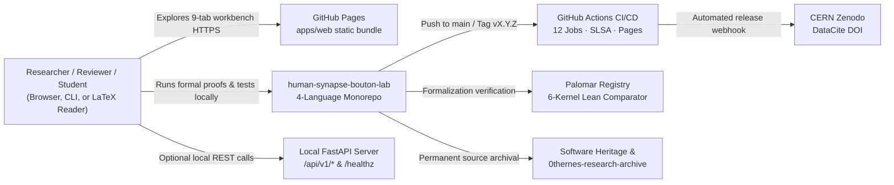

# Architecture

`human-synapse-bouton-lab` is a four-language scientific verification and interactive workbench architecture engineered so that formal proofs, arbitrary-precision reference arithmetic, high-speed deterministic Monte Carlo simulation, and interactive 2D/3D visualization continuously cross-check one another.

## C4 Level 1 — System Context



## C4 Level 2 — Container Diagram

```mermaid
flowchart TD
    L["lean/ (Lean 4.35.0)<br/>Challenge.lean & Solution.lean<br/>18 Proofs · 0 Sorry · 6 Kernels"] -->|Certifies exact algebraic invariants| PY
    PY["python/synapse_science/<br/>50-Digit mpmath Oracle + FastAPI<br/>Pre-Registered Stats + Media/Video"] <-->|1,000-case Differential Test (rtol <= 1e-10)| TS
    PY <-->|1,000-case Differential Test (rtol <= 1e-10)| RS
    RS["rust/synapse-sim/<br/>ChaCha8Rng Monte Carlo Engine<br/>proptest (2,000 cases) · Benchmarks"] -->|30-seed deterministic sweep| DATA["data/experiments/<br/>per_seed_results.csv<br/>stats_summary.json<br/>MANIFEST.sha256"]
    DATA --> PY
    TS["packages/synapse-core/<br/>Strict TypeScript Biophysical Core<br/>11-Discipline Open Problems<br/>fast-check (3,600+ cases)"] --> WEB["apps/web/<br/>Vite 6 + Three.js + Chart.js<br/>9-Tab Accessible Workbench<br/>GitHub Pages"]
    PY -->|Optional live /api/v1/*| WEB
    PY -->|Vector PDFs, PNGs, GIF, H.264 MP4| MEDIA["docs/media/ & papers/figures/"]
    MEDIA --> WEB
    MEDIA --> TEX["papers/wp1 & wp2 (AMS-LaTeX)<br/>Tectonic 0.17.0 -> dist/*.pdf & arXiv tarballs"]
```

## Components & Responsibilities

1. **Formal Proof Core (`lean/`):** Zero-Mathlib Lean 4.35.0 package proving exact natural/integer invariants for Hill $n=4$ cooperativity, KCC2 shunting inhibition, vesicle pool conservation (rat & human L1), ATP deficit & resting leak limits, kinesin-1 ATP cost, SNARE barrier monotonicity, RESI variance gain, and discrete bipartite causal coupling.
2. **Exact Oracle, Stats, API & Media (`python/synapse_science/`):**
   - `oracle.py`: 50-digit `mpmath` and exact `Fraction` ground truth (Build Standard B12).
   - `stats_experiments.py`: Paired/two-sample permutation tests, Cliff's $\delta$, Cohen's $d$, 10,000-resample 95% bootstrap CIs, Holm–Bonferroni correction, and `data/MANIFEST.sha256`.
   - `server.py`: FastAPI REST backend with Pydantic v2 schema contracts (`/openapi.json`), structured JSON request logging, and `/healthz`.
   - `generate_media.py`: Deterministic scientific figure, audited schematic blueprint, social preview, animated GIF, and H.264 MP4 video pipeline.
3. **Deterministic Native Simulator (`rust/synapse-sim/`):** Fast compiled Monte Carlo synaptic bouton engine using `ChaCha8Rng`, serving 30-seed pre-registered sweeps, 1,000-case differential batches, and honest warmup+10-run benchmarks (`0.3093 ms` median vs Node `1.8362 ms`).
4. **TypeScript Core & Interactive Web Workbench (`packages/synapse-core/`, `apps/web/`):** Zero-duplication shared library consumed by Vitest, differential tests, standalone examples, and the 9-tab accessible Vite/Three.js/Chart.js web application deployed to GitHub Pages.
5. **Publication Pipeline (`papers/`, `scripts/build_papers.py`, `dist/`):** Two AMS-LaTeX white papers compiled via Tectonic 0.17.0 with verified standalone arXiv tarballs and `dist/SHA256SUMS`.

## Scaling Plan (`P3.06`)

- **Web Workbench (`apps/web` on GitHub Pages):** Completely static HTML/JS/CSS served from GitHub's global CDN (`Fastly`). Compute runs in each visitor's browser, so server load scales linearly at zero cost up to GitHub Pages soft limits (`100 GB/month` bandwidth). *Trigger metric:* If traffic approaches `80 GB/month` or large video streaming degrades load times, offload `docs/media/*.mp4` to release asset links or a CDN bucket.
- **Monte Carlo Simulation (`rust/synapse-sim`):** Single-core median `0.3093 ms` for `5,000` action potentials (`5.94x` faster than Node). *Bottleneck & trigger:* Sweeps exceeding `10^7` action potentials or multi-bouton coupled networks (`> 60 s` wall clock) trigger adding `rayon` thread-pool parallelism or compiling `synapse-sim` to `wasm32`.
- **FastAPI Local Compute Server (`python/synapse_science/server.py`):** Stateless pure-math endpoints (`< 50 ms` p95). *Trigger metric:* If ever hosted remotely for concurrent users (`> 20 req/s`), run behind multiple `uvicorn`/`gunicorn` workers with rate limiting and strict payload bounds (already enforced at `2 MB` for trace payloads).

## Observability (`P3.09`)

- **Health Check Endpoint:** `GET /healthz` returns `{"status": "ok", "version": "<semver>", "oracle_precision_digits": 50}` with HTTP `200`.
- **Structured Logging:** `synapse_science.server` emits single-line JSON request logs (`timestamp`, `method`, `path`, `status_code`, `duration_ms`) with zero PII or secrets.
- **Continuous Verification Telemetry:** GitHub Actions CI (`.github/workflows/ci.yml`) runs 12 verification jobs on every push to `main` plus a weekly Monday `06:00 UTC` schedule (`Lean 6-kernel`, `TS/Vitest`, `Rust/proptest`, `Python/differential/mypy/ruff`, `Build Standard audit`, `gitleaks`, `osv-scanner`, `Tectonic papers`).
- **Pages Uptime & Deployment Status:** Verified automatically by `.github/workflows/pages.yml` and GitHub Pages HTTPS health checks.

## Architecture Decision Records

Every major structural choice is recorded in [`docs/adr/README.md`](adr/README.md).
