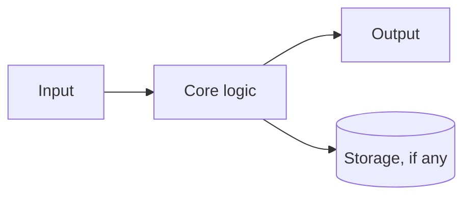

# Architecture

## Purpose

Full-stack, formally verified human synaptic bouton biophysical workbench, Lean 4.35.0 proofs, stochastic Monte Carlo nanocolumn simulator, and 11-discipline open hard problems & consciousness frontier monograph.

## Components

TODO(fill): replace the diagram with the real components and data flow.

| Component | Location | Responsibility |
|---|---|---|
| TODO(fill) | src/... | |

## Data flow

TODO(fill): how a request, command or run moves through the system.

## Key decisions

Recorded as ADRs in [adr/](adr/). Do not reverse a decision without writing a new ADR that supersedes it.

## Boundaries and threats

See [threat-model.md](threat-model.md).
